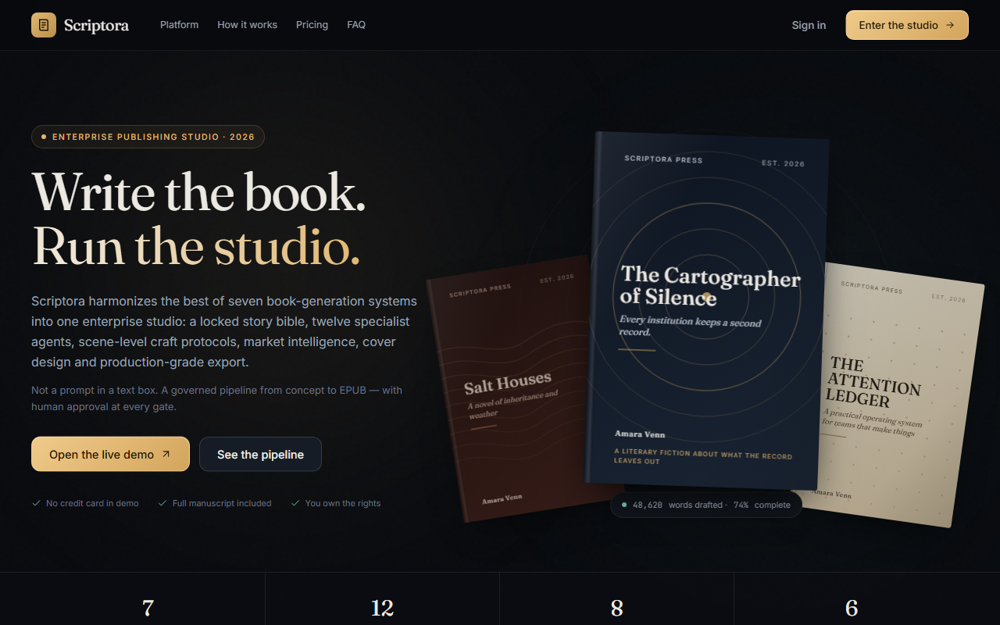
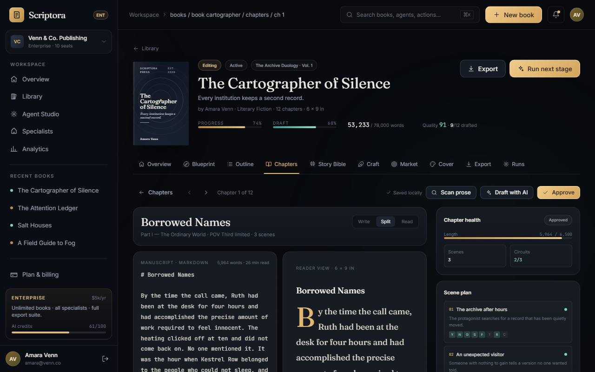

# Scriptora

**The enterprise AI publishing studio.** Concept → blueprint → outline → draft →
editorial → cover → EPUB/print. One governed pipeline, with a human at every gate.

Scriptora harmonizes the strongest ideas from Smithbook and seven open-source
book-production systems into a single studio: a locked story bible, twelve
specialist agents, scene-level craft protocols, market intelligence, a real
cover-design system and production-grade export.



> **Plan:** Enterprise, **$5,000 / year**. Unlimited books, ten seats, every
> specialist, every protocol, every export format.

---

## Run it

```bash
npm install
npm run dev
```

Open the printed URL. For a local production check:

```bash
npm run check     # svelte-check + TypeScript
npm run build     # Cloudflare Pages build
npm run preview
```

The Vite dev server emulates the Cloudflare platform in memory (`platformProxy:
{ persist: false }`), so a stale `.wrangler` SQLite lock cannot block startup.

### Demo entry

- Landing page → **Open the live demo**
- Or go directly to `/login?demo=1`

The demo signs in as **Amara Venn** at **Venn & Co. Publishing** and loads five
books, an editorial queue, agent runs, a full manuscript, a story bible, market
research, cover directions and a billed enterprise workspace.

No account, network, API key or payment is required. State persists in
`localStorage` (`scriptora.workspace.v1`).

---

## What is inside

### Studio

| Area | Capability |
| --- | --- |
| Overview | Production queue, word count, quality, activity, next best action |
| Library | Search, filter, sort, create, archive |
| Book workspace | Overview, blueprint, outline, chapters, story bible, craft, market, cover, exports, runs |
| Chapter editor | Markdown manuscript, split/read view, scene plan, health, approve, scan, AI draft |
| Agent Studio | Pipeline launcher, live steps and logs, cost/token accounting, routing, human gates |
| Specialists | Twelve agents with mandates, models, protocols and guardrails |
| Analytics | Throughput, spend, quality, genre mix, protocol coverage |
| Plan & billing | $5,000 annual enterprise plan, usage, invoices, seats |
| Settings | Workspace, members, provider routing, protocol defaults, exports |



### Production pipeline

`full-book`, `blueprint`, `draft`, `chapters`, `editorial`, `research`, `design`, `export`

Every run records:

- named steps with status and detail
- streaming-style log entries (`info`, `ok`, `warn`, `error`)
- model, token count, cost, progress
- human review gates that an agent cannot bypass

### Harmonized feature map

| Source | Adopted |
| --- | --- |
| **Smithbook** (observed live via REA) | Guided manuscript studio, conversational brief intake, chapter ledger, premium editorial feel, billing/onboarding flow |
| **AI-Book-Generator** | Multi-provider routing, agent mode, streaming progress, cover generation, multi-format export |
| **LibriScribe** | Specialist agents (`concept`, `outliner`, `chapter_writer`, `character`, `worldbuilding`, `editor`, `fact_checker`, `plagiarism`, `style`), narrative graph and canon invariants |
| **book-generator** | KDP market analysis, topic/comp scoring, cover pipeline, front/back matter, compile-and-validate export |
| **writing-template-for-ai** | `BOOK_BLUEPRINT.md`, genre routing, five prose protocols: AI-ism suppression, semantic gradient, Yorke dramatic architecture, character hierarchy, fractal scene architecture |
| **bookwriter** | Outline-first workflow, chapter targets, revision passes |
| **awesome-ai-book-writing** | Prompt and tooling catalog used to choose the specialist behaviors |
| **ai-book-generator** | Lightweight genre-aware generation and export patterns |

### Design system

- Dark archival canvas `#080a0e`, gold `#e0b872`, teal `#7dd3c0`
- Fraunces for display, Inter for UI, JetBrains Mono for data
- Custom cover renderer: six palettes, six motif systems, four type directions,
  front/back/spine, print-safe colors
- Responsive app shell, command palette (`⌘K`), toasts, modals, progress,
  sparklines, donuts and manuscript typography
- All UI is hand-built; no component kit or template theme

### Craft protocols

The genre router applies fiction protocols only to fiction, and swaps in
nonfiction protocols for business, self-help, essay and how-to books:

1. **AI-ism suppression** — remove stock phrasing, hedges and symmetrical
   paragraph rhythms
2. **Semantic gradient** — every scene must change the reader's understanding
3. **Yorke dramatic architecture** — desire, opposition, cost, resolution
4. **Character hierarchy** — tiered cast with want/need/wound and screen time
5. **Fractal scene architecture** — the eight-step circuit at scene and chapter
   scale
6. **Continuity invariants** — canon locks checked before export
7. **Voice anchor** — sampled style contract reapplied per chapter
8. **Human approval gates** — blueprint, continuity, cover and release

---

## Stack

| Layer | Choice |
| --- | --- |
| UI | Svelte 5 (runes), SvelteKit 2 |
| Styling | Tailwind CSS 4 via `@tailwindcss/vite` |
| State | `StudioStore` class with `$state`, `$derived`, `$effect` + localStorage |
| Backend | Convex schema and functions in `convex/` (optional production adapter) |
| Deploy | `@sveltejs/adapter-cloudflare` → Cloudflare Pages |
| Export | JSZip EPUB 3, print-ready HTML/PDF, Markdown, HTML, TXT, JSON, DOCX-compatible |
| Research | REA 6.4 runtime observation of smithbook.com + source inspection of seven repos |

### Convex

`convex/` contains the production schema and queries/mutations for workspaces,
users, books, chapters, agent runs, activities and invites. The demo is
deliberately self-contained; see [`convex/README.md`](convex/README.md) to
provision a deployment and set `PUBLIC_CONVEX_URL`.

### Cloudflare Pages

```bash
npm run build
npx wrangler pages deploy .svelte-kit/cloudflare
```

Or connect the repo to Cloudflare Pages:

- Build command: `npm run build`
- Output directory: `.svelte-kit/cloudflare`
- Node version: 22+

---

## Project layout

```
src/
  app.css                    design tokens, components, manuscript styles
  lib/
    types.ts                 domain model
    engine.ts                deterministic concept/outline/prose/research/craft/cover
    pipeline.ts              auditable agent pipelines
    seed.ts                  demo workspace + five books
    store.svelte.ts          reactive store + persistence
    export.ts                EPUB 3, print, Markdown, HTML
    components/              shell, covers, icons, charts, runs, modals
  routes/
    +page.svelte             marketing site
    login/ onboarding/
    app/                     studio shell
      books/[id]/            book workspace
convex/                      schema, books, runs, workspace
research/
  README.md                  evidence and source notes
  rea/                       REA observation artifacts
```

---

## Evidence and method

Smithbook is Cloudflare-protected and blocks ordinary fetches. The live product
was observed with **REA 6.4** (`rea capture-browser-scenario`) using Playwright
Chromium, capturing DOM, accessibility tree, screenshots and network/console
events for:

- `https://smithbook.com/`
- `https://writer.smithbook.com/makemybook`

Artifacts live in [`research/rea/`](research/rea). The seven repository sources
were cloned and inspected for agent architecture, prompts, protocols, export
formats and market analysis. See [`research/README.md`](research/README.md).

The app is a deterministic demo: prose, research, craft reports and covers are
generated locally from seeded inputs, so every flow is reproducible and no
provider key is exposed. Provider routing UI, cost caps, token accounting and
the Convex schema are production-shaped and ready to connect.

---

## Rights

All demo titles, characters, prose and covers are original synthetic content
created for this project. No Smithbook or repository content is reproduced.

**Scriptora** — built 2026.
